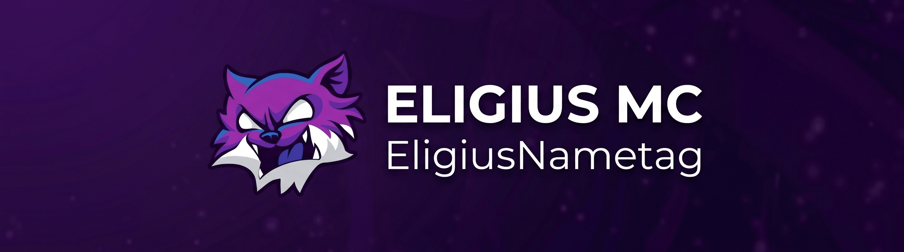

<div align="center">
  

  # EligiusConnector

  *The ultimate Discord ↔ Minecraft bridge plugin for Bukkit, Spigot, Paper, Purpur, and Folia.*

  [](https://papermc.io/)
  [](https://papermc.io/software/folia)
  [](https://adoptium.net/)
  [](LICENSE)
  [](https://github.com/Eligiusmc/EligiusConnector/releases)

  [🐛 **Report an Issue**](https://github.com/Eligiusmc/EligiusConnector/issues)

</div>

---

## 🌟 Overview

**EligiusConnector** is a comprehensive Discord ↔ Minecraft integration plugin that bridges chat, player events, verification, synchronization, dynamic counters, and more — all configurable via YAML with full i18n support.

### ✨ Key Features

- 💬 **Chat Bridge:** Bi-directional MC ↔ Discord chat with webhook support, anti-spam, profanity filter, link filter, and caps filter
- 👋 **Player Events:** Join, leave, death, and advancement announcements with fully customizable embeds
- 🔐 **Account Verification:** Link Minecraft accounts to Discord with alphanumeric codes, DM confirmation, and post-verify commands
- 🔄 **Role Sync:** Bi-directional group ↔ role synchronization via Vault and LuckPerms
- 📊 **Dynamic Counters:** Periodic and state-based Discord channel name updates (online players, total members, server status)
- 📱 **Profile Panels:** Interactive Discord buttons for player profile, inventory, location, and economy balance
- 🌐 **Multi-language:** Full i18n with 6 built-in languages (en, es, de, fr, pt, ru)
- 🔧 **Modular Architecture:** Enable/disable features per module via YAML configs
- 🚀 **Native Folia & Paper Support:** Async scheduler with automatic platform detection
- 💾 **Smart Persistence:** SQLite and MySQL support via HikariCP
- 📊 **bStats Integration:** Anonymous metrics to help the plugin grow

---

## 🚀 Quick Installation

> [!WARNING]
> **PlaceholderAPI is recommended** for full placeholder support. The plugin works without it, but `%placeholders%` in embeds will show as literal text.

1. Download the latest `EligiusConnector-x.x.x.jar` from the [Releases page](https://github.com/Eligiusmc/EligiusConnector/releases)
2. Drop it into your `plugins/` folder
3. **Recommended plugins:** PlaceholderAPI, Vault, LuckPerms, EssentialsX
4. Start your server and configure the YAML files in `plugins/EligiusConnector/`
5. Set your Discord bot token in `config.yml`

---

## 💻 Commands & Permissions

| Command | Description | Permission |
|---------|-------------|------------|
| `/verify <code>` | Link your Minecraft account | `connector.verify` |
| `/unlink [player]` | Unlink accounts | `connector.unlink.self` / `.other` |
| `/connector reload` | Reload configuration | `connector.reload` |
| `/connector status` | View plugin status | `connector.admin` |
| `/events list/start/stop` | Manage custom events | `connector.events` |
| `/chat <message>` | Send message to Discord | `connector.chat` |

---

## 📁 Configuration

All modules are configured via individual YAML files in `plugins/EligiusConnector/`:

| File | Module |
|------|--------|
| `config.yml` | Bot token, database, language |
| `chat.yml` | Chat bridge + filters |
| `player_events.yml` | Join/leave/death/advancement embeds |
| `verify.yml` | Verification panel + DM embed |
| `profile.yml` | Profile/inventory/whereami/money panels |
| `status.yml` | Server online/offline embeds |
| `counters.yml` | Dynamic channel name counters |
| `synchronization.yml` | Role sync + nickname sync |
| `console.yml` | Console log relay |
| `lang/*.yml` | Translations (en, es, de, fr, pt, ru) |

---

## 👨‍💻 For Developers

We love Open Source code. If you wish to contribute:

1. The project requires **Java 21 LTS** to compile
2. Clone the repository and build with Gradle:

```bash
git clone https://github.com/Eligiusmc/EligiusConnector.git
cd EligiusConnector
./gradlew build shadowJar
```

### Conventions
- **Branching:** Work from `develop` towards `feature/<name>` branches
- **Commits:** Use Conventional Commits (`feat:`, `fix:`, `refactor:`, etc.)
- **Architecture:** Hexagonal Architecture (ports and adapters)
- **i18n:** All user-facing text goes through language files
